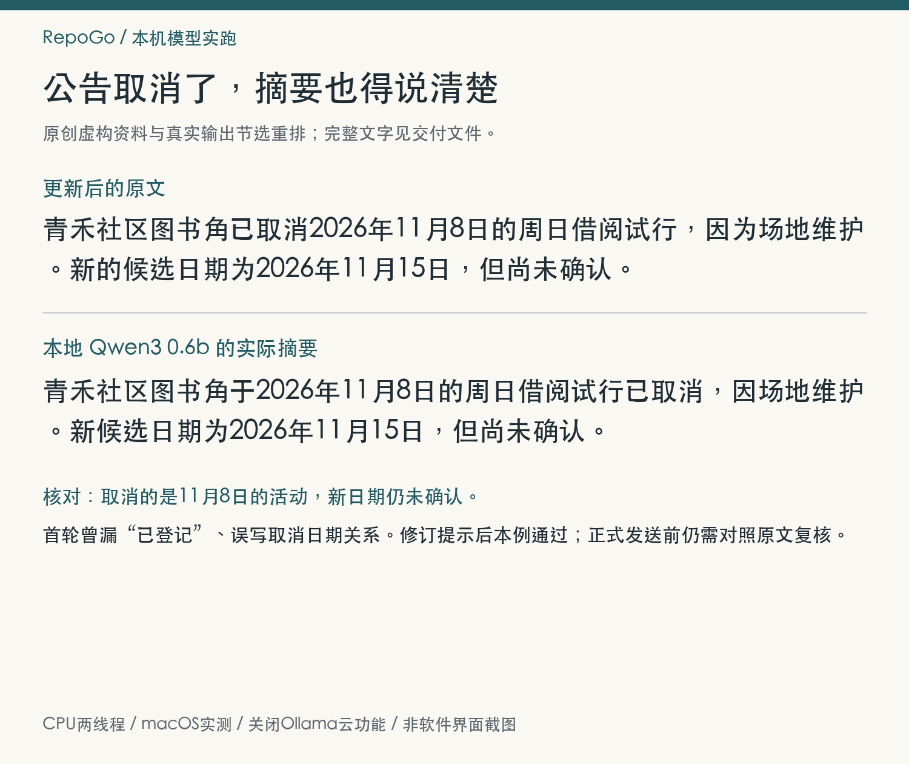
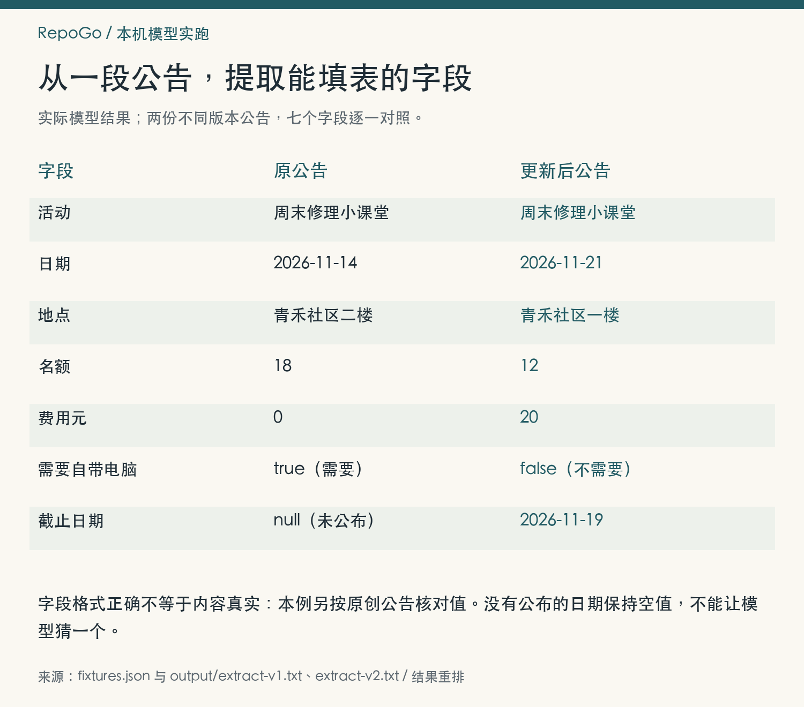
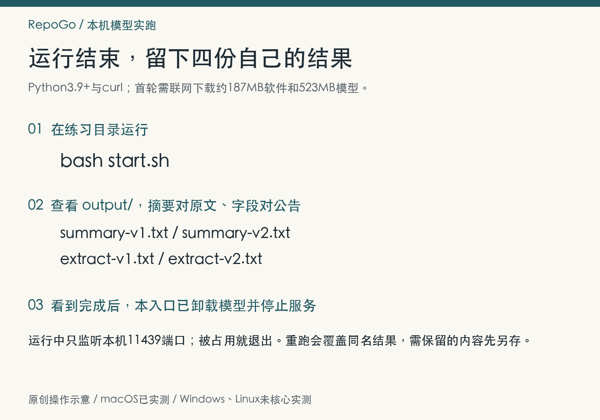

# 中文资料留在本机：摘要与公告字段提取

同一段公告，可能要变成群里的一段话，也可能要填进活动表格。Ollama 提供的是在本机运行模型和调用模型的入口。它本身不是专门的摘要软件；本练习把它接到两个明确任务上。

本期用固定的 **Ollama 0.40.13 + Qwen3 0.6b Q4_K_M**，实际完成：

1. 将一段中文借阅安排压缩成摘要，随后把“拟开放”改成“已经取消”，检查新摘要是否跟着变化。
2. 从活动公告提取日期、地点、人数、费用等七个字段。新公告改了日期、楼层、人数和是否自带电脑，输出随之更新；没有公布的截止日期保留 `null`，意为“没有提供”，而非猜日期。

资料均为原创虚构练习。真实模型输出未手动修饰。最初的摘要曾漏掉“已登记”限制，也把取消活动的日期关系写错；提示修订后，本期四份固定样例核对通过。**这不代表模型以后不会漏字或误读，摘要仍需要对照原文复核。**

## 先看结果





图为真实输入输出的原创重排，不是 Ollama 图形界面截图。文件中的完整文字比缩略图更适合逐条复核。

## 如何开始

本期实际通过：macOS 26.5、Apple M4、24 GiB 总内存，CPU 模式两线程。模型驻留内存约784 MB，不是最低系统要求。需要 Python 3.9+、curl 和首次下载网络；不需要新的模型账号、API key 或付费调用。

在本目录执行：

```sh
bash start.sh
```

入口准备固定版本官方 CLI 和真实模型，启动 `127.0.0.1:11439`，生成四份输出，卸载模型，停止本入口启动的服务。查看 `output/summary-v1.txt`、`summary-v2.txt`、`extract-v1.txt`、`extract-v2.txt` 和 `verification.json`。默认首次下载软件约187 MB、模型约523 MB；建议给下载、解压和结果预留至少2 GiB磁盘空间。首次服务启动会在用户目录生成 Ollama 自己的本地密钥，详见 [RUN.md](RUN.md)。



单独运行一个用途：

```sh
bash start.sh --task summary
bash start.sh --task extract
```

Windows ARM64 有 `start.cmd`，Linux 和 Windows x64 可传已有官方 CLI 路径；本期尚未完成这两个系统的核心实测。请先读 [RUN.md](RUN.md)，不要将“有入口”理解成“都已验证”。

## 换成自己的资料

编辑 `fixtures.json` 中的 `text`。`summary` 类型输出一段中文摘要；`extract` 类型返回规定字段。提取模板的字段定义在 `requests/extract-v1.json` 的 `format` 中，这是告诉模型“结果应该长什么样”的 JSON 结构约束。

若修改结构化样例，必须同步调整 `expected`：它是本期练习的正确答案，用来发现遗漏，不是发给模型的答案。原文没有的信息，不能靠改预期把猜测变成通过。摘要没有自动判真，需要自己逐句核对。

这套小模型适合先尝试短资料。长文、数字计算、法律医疗判断、复杂多轮推理不在本期验证范围。首次下载需要联网；本入口关闭 Ollama 云功能，但没有做断网抓包测试，也不把“本地推理”当作整台电脑的隐私保证。

## 来源和本期增量

- 上游：[ollama/ollama](https://github.com/ollama/ollama)，MIT；支持本地模型、CLI、REST API 以及多个系统，支持范围以官方文档为准。
- 模型：[Qwen3 0.6b](https://ollama.com/library/qwen3:0.6b)，本期官方 registry 权重许可为 Apache-2.0；模型许可独立于 Ollama 软件许可。
- RepoGo 增量：中文启动与停止入口、固定软件及模型指纹、两个原创任务、改输入复核、摘要失败案例和排错说明。没有把原项目包装成自行研发的模型。

本仓库只提供原创练习与说明，不随仓库附带上游二进制或模型权重；首次运行直接从官方地址下载。AI 辅助编写与整理，实际输入输出有对应证据。
